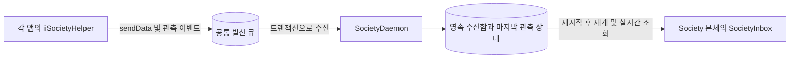

# SocietyDaemon

NAS·자체 호스트 서버에서는 `--sync --container PATH --server URL --host`로 화면 없이 컨테이너를 제공한다. `--login-file`의 계정 로그인, TLS 웹서버 배치, systemd 예제와 검증 범위는 [자체 호스팅 문서](SelfHosting.md)에 있다. 데스크톱 GUI가 저장한 계정별 서버 설정도 기존 세션 복원 시 공유한다.

Society 창과 별도 수명을 갖는 사용자 세션의 수신 서비스이다. 모든 iiSocietyHelper 참여자가 남긴 데이터를 받아 영속 수신함에 보관한다. Society 본체는 나중에 실행해도 데이터를 읽고, 실행 중에는 새로운 데이터를 계속 전달받는다.

데몬은 시작 시 현재 선택된 `.societycontainer` 패키지를 열어 iiSocietyContainer의 정리 작업을 등록하고, 5분마다 저장소 선택을 다시 확인한다. 계정 로그인이나 네트워크 소유권 없이도 SDK의 최초 검사와 5분 간격 검사가 동작하므로 창이 닫힌 상태에서도 사용이 끝난 임시 파일을 삭제하고 내부 로그는 폴더별 최신본 하나만 보존한다. 진행 중인 가져오기·파일 교체·동기화는 shared lease로 보호한다. 공유 설정에 저장된 과거 이미지는 열거나 복원하지 않는다. `daemonMaintainsSelectedFolderWithoutAnAccount`는 실제 데몬 프로세스가 계정 없이 선택된 패키지의 임시 파일을 삭제하는지 검증한다.

임시 파일 lease가 없는 구버전 GUI를 유지한 채 새 정리 데몬만 먼저 실행하면 안 된다. 업데이트 시 작업 중인 창을 보존하려면 새 번들을 설치하되, 기존 GUI가 종료된 뒤 등록된 데몬을 재시작한다. 같은 앱 경로·LaunchAgent plist·서명 식별자를 유지하는 SDK 업데이트에서는 이 전환에 기존 서비스의 `launchctl kickstart -k gui/<uid>/com.iisacc.society.daemon`을 사용할 수 있다. 실제 프로세스 교체와 새 SDK의 로딩을 확인하기 전까지 실행 중 데몬에 정리 정책이 적용되었다고 보고하지 않는다.



## 수명과 데이터 보장

- Helper와 데몬 모두 같은 컨테이너 내부 `SOCIETY_HELPER_DIRECTORY` 또는 `.society-runtime/helpers/v1` 기본 위치를 사용한다. 데이터는 그 아래 `delivery/delivery.sqlite`에 기록한다. Society 콘텐츠 드라이브의 Files/·Models/에는 넣지 않는다.
- 데몬은 창이 없는 Qt Core 실행 파일이다. 단일 소유자 잠금으로 같은 저장 위치에 두 데몬이 수신을 수행하지 못하게 한다. 강제 종료 후 새 프로세스가 잠금을 회수한다.
- 250 ms마다 최대 128개 메시지를 수신하고, 1초마다 또는 관측 목록 변경 시 마지막 상태를 저장한다. 이는 OS 스케줄링과 저장 장치 응답에 따른 지연이 있는 폴링 주기이다.
- SQLite 트랜잭션으로 outbox → inbox 이동과 발신 제거를 함께 커밋한다. 오류나 중단이 발생하면 발신 데이터를 남기며 재처리한다. 같은 메시지 ID를 수신함에 중복 저장하지 않는다.
- 본체가 닫히면 데몬은 계속 실행된다. 데몬도 꺼져 있으면 Helper 발신 큐에 저장되며 데몬 재시작 후 수신한다. 이미 수신된 데이터는 데몬 없이도 본체가 읽을 수 있다.
- 본체의 `societyInbox` 컨텍스트 객체는 `dataReceived`, `messages`(최근 100개), `readAfter`, `lastSequence`, `acknowledge`를 제공한다. 전체 기록은 페이지로 다시 읽을 수 있다.
- ACK는 앱의 업무 처리가 끝난 뒤 명시적으로 한다. 자동 ACK하지 않으며, 처리 확인 전 앱 재실행은 같은 메시지를 다시 전달할 수 있다. 수신함 자체는 자동 삭제하지 않는다.
- 마지막 데몬 스냅샷은 마지막 기록 시점의 상태이다. 현재 실행 여부는 Helper의 생존 관측 또는 OS 서비스 상태로 확인한다. 앱 ID는 협력 앱이 선언하는 식별자이며 인증 기능은 아니다.

외부 메시지 브로커나 새 데이터베이스 서버를 도입하지 않는다. 기존 Qt 6.8.3의 Sql/QSQLITE와 SQLite WAL·FULL 동기화를 사용한다. 직접 파일 저널과 복구 프로토콜을 구현하는 것보다 기존 트랜잭션을 이용하는 편이 유지보수 부담이 낮다. Qt·SQLite의 라이선스는 사용 중인 Qt 배포본을 따른다.

## macOS 백그라운드 등록

`tools/deploy_macos_runtime.py`는 본체와 데몬의 Mach-O 의존성을 분석하고 CMake에서 선택한 SDK 버전을 우선하여 배포한다. iiWebServer의 libcurl과 Brotli 같은 간접 의존성도 포함하며, 특정 패키지 관리자의 설치 위치를 하드코딩하지 않는다. 패키지 검증은 외부 라이브러리 로딩·누락된 간접 dylib·번들 밖을 가리키는 라이브러리 심볼릭 링크를 거부한다.

Society.app 안에 다음 두 파일을 포함한다.

- `Contents/MacOS/SocietyDaemon`
- `Contents/Library/LaunchAgents/com.iisacc.society.daemon.plist`

SMAppService의 LaunchAgent로 등록한다. 시스템 전체 root 데몬이 아닌 현재 로그인 사용자의 서비스이므로 같은 사용자의 Helper 저장 위치를 사용한다. 등록이 활성화되면 창 종료 후에도 실행하고 다음 로그인 시 다시 시작하며, 종료되면 launchd가 다시 가동한다. 실행 파일은 앱 번들 상대 경로를 사용한다. 외장 드라이브의 앱 번들이 접근 가능해야 한다.

일반 Society 실행 시 등록을 시도한다. `SOCIETY_HELPER_DIRECTORY`가 명시된 격리 실행은 사용자 로그인 서비스를 바꾸지 않는다. 명령행에서도 등록 상태를 관리할 수 있다.

```sh
build/bin/Society.app/Contents/MacOS/Society --daemon-service status
build/bin/Society.app/Contents/MacOS/Society --daemon-service register
build/bin/Society.app/Contents/MacOS/Society --daemon-service unregister
```

반환 JSON의 `status`는 enabled/requires-approval/not-registered/not-found/unsupported 중 하나이다. 등록 결과와 실제 데몬의 실행은 별도로 확인한다. macOS가 백그라운드 항목 승인을 요구하면 그 상태를 반환하며 성공으로 보고하지 않는다. 창을 닫는 것은 서비스를 해제하지 않는다.

SMAppService는 서명된 번들을 요구한다. 데몬의 Qt·Helper·SQLite 드라이버도 앱 번들에 포함해야 한다. 외장 볼륨에 있는 개발용 SDK를 직접 참조하면 launchd가 데몬을 시작해도 macOS의 외장 볼륨 접근 처리에서 라이브러리 로딩이 대기할 수 있다. 등록된 바이너리나 plist를 갱신할 때에는 기존 서비스를 해제하고 패키징한 뒤 다시 등록해야 한다.

```sh
build/bin/Society.app/Contents/MacOS/Society --daemon-service unregister
cmake --build build --target SocietyDaemonPackage
/System/Library/Frameworks/CoreServices.framework/Frameworks/LaunchServices.framework/Support/lsregister -f "$PWD/build/bin/Society.app"
build/bin/Society.app/Contents/MacOS/Society --daemon-service register
```

`Society` 빌드는 `build/bin/Society.app`의 본체와 내장 데몬에 필요한 런타임을 함께 준비한다.
Qt의 qmlimportscanner로 필요한 QML 모듈을 찾고 Mach-O 의존 그래프에 따라 프레임워크를 배치하며, CMake에서 선택한 LVRS·SDK 및
OpenSSL·curl 등의 네이티브 의존성을 번들 내부 상대 경로로 고정한다. Qt 플러그인은
플랫폼·이미지·아이콘·네트워크 정보와 실제 사용하는 SQLite·SecureTransport로 한정한다.
ODBC·PostgreSQL·Mimer 드라이버의 별도 설치를 앱 시작 조건으로 만들지 않는다.
`SocietyDaemonPackage`는 이 준비된 앱을 제자리에서 검증하며 복사본을 만들지 않는다.

`SOCIETY_MAC_SIGN_IDENTITY`의 기본값 `-`는 로컬 ad-hoc 서명이다. 라이브러리·프레임워크·
내장 데몬·본체 순서로 서명하며 보안 타임스탬프를 요청하지 않는다. 개발자 서명은 같은
CMake 설정으로 지정한다. 로그인 서비스 등록·실제 수신·공증은 런타임 포함 검사와 별개이다.

데몬은 `Contents/MacOS/SocietyDaemon` 일반 실행 파일이며 GUI와 본체의 Frameworks·PlugIns를 공유한다.
GUI는 본체의 Resources/qml을 사용한다. 본체와 데몬 모두 개발 머신의
DYLD 환경 변수나 SDK 설치 경로에 의존하지 않아야 한다. SDK를 갱신하면 CMake에서 선택한
버전을 다시 복사하므로 과거에 배포한 컨테이너 런타임이 새 SDK를 가리지 않는다.

빌드 후 `verify_macos_runtime.py`는 DYLD·Qt·QML 검색 경로를 제거한 환경에서 본체의 읽기 전용
서비스 상태 조회와 데몬의 `--check-runtime`을 실행한다. 실제 로더가 번들 외부의 비시스템
라이브러리를 읽으면 실패한다. `Society.MacRuntimeLaunch`는 사용자 설정과 분리된 임시 경로에서
컨테이너 없는 GUI 시작, QML 루트 생성 및 플러그인 로딩까지 검사한다.
`Society.MacRuntimeDeployment`는 실제 Mach-O 시험 바이너리로 누락된 OpenSSL 경로,
선택한 SDK 버전 우선순위, 원본 디렉터리가 사라진 뒤의 전이 의존성 로딩을 검증한다.
MLX의 Metal 라이브러리는 `Resources`에 저장하고 `Frameworks`의 상대 심볼릭 링크로
탐색을 유지한다. 이 리소스 배치도 서명 검증에 포함한다.
패키지 복사 직후 데몬의 최초 라이브러리 로딩에는 추가 시간이 걸릴 수 있으므로,
패키지 검사의 데몬 명령은 각각 최대 60초를 허용한다.

위 갱신 예시는 기존 패키지가 등록된 경우이다. 최초 설치에서는 해제 단계를 생략한다. 앱 위치나 서명·helper 구성을 변경한 개발 패키지는 해당 앱만 Launch Services에 다시 등록해 메타데이터를 갱신한다. 다른 앱의 백그라운드 설정을 초기화하지 않는다.

## 진단과 플랫폼

macOS 또는 다른 데스크톱에서 창 없이 직접 실행할 수 있다. 진단용 컨테이너는 먼저 앱이나 SDK로 build/ 안에 생성하며, 진단 생성물도 그 패키지 안에 둔다.

```sh
build/bin/SocietyDaemon --container "$PWD/build/verification.societycontainer" \
  --directory "$PWD/build/verification.societycontainer/.society-runtime/helpers/v1" \
  --exit-after-ms 15000
```

`--exit-after-ms 15000`은 유한 시간의 진단 실행에 사용한다. SIGTERM/SIGINT는 이벤트 루프에서 정상 종료하고, SIGKILL 뒤에도 수신함과 미처리 발신 큐가 남는다. Qt 로그 범주는 `iisacc.society.daemon`, `iisacc.society.inbox`, `iisacc.society.helper`이며 메시지 ID·앱 ID·토픽을 기록하고 사용자 payload는 로그에 출력하지 않는다.

iOS는 독립 상주 데몬을 지원하지 않는다. 선택한 `.societycontainer`의 `.society-runtime/helpers/v1` 안에 발신 데이터를 보관하고, Society 앱이 실행되는 동안 `SocietyDaemonService`로 수신한다. `SocietyRuntime`은 중단 때 Helper의 마지막 이벤트를 기록하고 수신기 잠금·DB 연결을 해제한다. 복귀 때 영속 ACK를 복원하여 누적 데이터를 수신하고, 실행 중 시작 실패도 재시도한다. Inactive는 파일 선택기에서도 발생하므로 중단으로 취급하지 않는다. 호스트의 `Society.MobileLifecycle`이 이 복구 경로를 검증한다. 실제 iOS 빌드·기기 검증 상태는 [iOS 구현 문서](iOS.md)를 따른다. Android 앱 간 저장 위치와 Windows/Linux 로그인 서비스 등록은 아직 별도 구현 대상이다. 현재 서비스 등록과 프로세스 실행 검증 대상은 macOS이다.

## 검증

`Society.Daemon`은 단일 데몬 잠금, 본체 실행 전의 데이터 보관, 늦게 시작한 수신 객체, 처리 확인, 실제 프로세스 강제 종료·재시작, 본체 실행 파일의 과거 데이터 수신, 본체 종료 후 데몬 생존을 검사한다. SDK의 delivery 테스트는 수신 실패 트랜잭션 롤백, 순번 페이지 읽기와 확인 위치도 검증한다. 테스트는 모두 build/ 안에 격리하고 실제 사용자 로그인 서비스를 등록하지 않는다.

근거: [SMAppService](https://developer.apple.com/documentation/servicemanagement/smappservice), [등록과 다음 로그인 실행](https://developer.apple.com/documentation/servicemanagement/smappservice/register()), [Qt SQL 드라이버](https://doc.qt.io/qt-6.8/sql-driver.html), [SQLite WAL](https://sqlite.org/wal.html), [iOS 백그라운드 실행](https://developer.apple.com/documentation/xcode/configuring-background-execution-modes).

## 기기 간 동기화 런타임

로그인 서비스는 --sync로 시작하며, Helper 수신과 함께 같은 계정의 Society 자동 연결·iiSocietyHelper Sync 0.4.0을 실행한다. 창이 열려 있는 동안 GUI가 기기 실행 소유권을 갖고 데몬은 수신함 처리만 계속한다. 창이 종료되면 최대 다음 250ms 소유권 검사에서 데몬이 선택 경로·암호화된 계정 상태를 복원하고 재연결한다. GUI 재실행 시 데몬의 네트워크 객체·작업 스레드를 먼저 종료한 다음 소유권을 넘긴다. 로그인 서비스의 실행·서명·App Group 권한과 실제 기기 동기화 완료는 별도 검증한다.

데몬 번들은 본체와 같은 SocietyAppGroup·App Group entitlement와 Bonjour/로컬 네트워크 설명을 갖는다. 계정의 Qt Quick 화면 등록은 헤드리스 데몬에 포함하지 않는다. 기존 Qt Core/Gui/Qml/Network/Sql 및 SDK를 재사용하며 새 외부 의존성은 없다. --sync 없는 격리 수신함 검사는 기존처럼 로컬 Helper 수신만 수행한다. iOS·Android에서는 별도 데몬 대신 [동기화 수명](Synchronization.md)의 OS 백그라운드 작업을 사용한다. Windows/Linux는 같은 데몬 실행 파일을 직접 사용할 수 있으나 로그인 서비스 자동 등록은 macOS 전용이다.

`--check-runtime`은 서비스·사용자 계정을 열지 않고 SQLite와 TLS 백엔드의 실제 로딩 결과를 JSON으로 반환한다. 패키지 검사는 외부 DYLD/Qt 경로를 제거한 환경에서 이 검사를 실행한다. `--status-file <절대 경로>`를 명시하면 기밀 데이터 없이 소유권·로그인 여부·컨테이너 준비·연결·전송 상태를 기록한다. Society.SyncOwnership은 별도 GUI 모사 프로세스를 강제 종료한 뒤 데몬이 남은 잠금을 회수하는 경로도 검사한다.

GUI도 소유권 반환 시 closeAndWait()로 SDK 작업 큐의 종료를 기다린다. 디스크 해시 계산 취소가 끝나기 전에 새 데몬이 같은 저널을 여는 간극을 방지한다. 반대 방향은 데몬의 NetworkDriveController 파괴와 작업 스레드 join이 끝난 뒤 소유권을 반환한다.

여러 SDK staging 경로가 같은 install name을 제공하면 CMake에서 선택한 동적 라이브러리를
우선 사용한다. 명시하지 않은 전이 의존성은 원본 라이브러리의 loader path·rpath와 지정된
런타임 검색 디렉터리에서 해결한다. 찾지 못한 의존성은 빌드 오류이다.
`verify_daemon_package.py`는 내장된 iiSocietyContainer Core·Gui의 Mach-O UUID를 선택된 SDK와
대조하며, 본체와 데몬의 실제 로더 검사는 Qt 및 네이티브 라이브러리의 외부 경로 사용을 거부한다.


## 단일 컨테이너 관리 범위

기본 Helper 관찰·전달 데이터는 선택한 `.societycontainer/.society-runtime/helpers/v1`, 계정·페어링 암호문은 `state`, 동기화 소유권은 `sync` 하위에 보관한다. GUI와 데몬은 동일 패키지를 사용하며 선택 변경 시 이전 소유권과 관찰 서비스를 해제한다. 선택 전에는 데몬이 쓰기 없이 기다리며 폴더 선택 후 다시 연결한다. SDK의 `SharedStorage::runtimePath`는 경로 조회만 수행하고 명시적 생성은 `ensureRuntimeDirectory`로 수행한다.

기존 OS 계정 암호문은 해당 레코드 조회 때 원본을 읽기 전용으로 접근하여 바이트와 철회 마커를 그대로 이전한다. 플랫폼 Keychain의 키와 작은 OS 저장소 선택 포인터는 그대로 사용한다. 이전 디스크 이미지를 복원하지 않는다. 명시적 `--directory`·Helper override·`--status-file`도 선택한 패키지의 `.society-runtime` 밖이면 시작 전에 거부한다. SDK의 저수준 명시 전송 경로는 통합 테스트를 위해 별도로 유지한다.

QML 디스크 캐시는 끈다. 모델 병합은 컨테이너 내부의 개별 `.society-model-merge-<UUID>` 작업공간에 변환·Python·Torch·HF 임시 파일을 모으고 완료·실패·취소 후 즉시 제거한다. 실행 중에는 작업공간의 직접 부모와 출력 부모의 `iiFileProvider::TemporaryLease` 공유 잠금을 유지하여 정리 작업이 활성 파일을 삭제하지 못하게 한다.

계정 및 네트워크 회귀 테스트는 실제 계정 응답과 등록한 호스트 컨테이너를 사용한다. 테스트의 세션·페어링 자격 증명은 메모리 저장소에만 보관하며, 원격 서버의 계정 주체가 로그인 계정과 다를 때의 연결 거부도 검증한다. 계정 미등록 연결을 허용하는 테스트용 제품 분기는 추가하지 않는다.

The packaged helper discovery regression allows up to 25 seconds for the cold application bootstrap and includes captured application output on failure.

## Container monitoring and app state delivery

`SocietyContainerDaemon` is a separate, Qt-free C++23 service provided by
`iiSocietyHelper::Monitoring` from the iiSocietyHelper package. The existing `SocietyDaemon` retains synchronization,
account restoration and delivery-queue responsibilities. Both plain executables
ship inside the single `Society.app/Contents/MacOS` directory.

The monitor follows Society's existing `storage.json` selection, validates the
container UUID and scans public filesystem metadata every second. It publishes
an atomic credential-free snapshot at
`.society-runtime/monitor/v1/state.cbor`. Apps subscribe through
`iiSocietyHelper::FileSystem::containerState` and `containerStateChanged`; QML
uses `societyHelper.fileSystem.containerState`. GUI callbacks are marshalled onto
the object's thread. The existing mirror refreshes on changed revisions. Its
2-second fallback timer remains active for replicas and partial inventories,
and resumes when the daemon is absent or stale.

The macOS login agent is `com.iisacc.society.container-monitor`, with RunAtLoad and
KeepAlive enabled. Society registers both agents on ordinary startup. Explicit
management is available through:

```sh
Society.app/Contents/MacOS/Society --container-monitor-service register
Society.app/Contents/MacOS/Society --container-monitor-service status
Society.app/Contents/MacOS/Society --container-monitor-service unregister
```

Isolated app tests set `SOCIETY_HELPER_DIRECTORY` to prevent login-service
registration. The native daemon also accepts `--selection-file`, `--root`,
`--identifier`, bounded scan limits, `--watch`, `--read-state` and
`--exit-after-ms` for process-level diagnostics. Windows/Linux can run the
standalone executable; this change does not install a system service there.
iOS/Android do not ship a resident desktop daemon. See the SDK's `Protocol.md`
for completeness, liveness, identity and metadata-only detection semantics.

The bundled runtime verifier allows 90 seconds for a cold launch of the GUI
loader and legacy daemon. A freshly signed bundle includes large model/Qt
runtimes, and its first filesystem/signature validation can exceed 30 seconds.
This deadline does not change the native monitor's one-second scan interval or
five-second heartbeat expiry.


## GUI 수신 폴링의 스레드 소유권

SocietyInbox의 250ms 타이머는 디스크·SQLite 조회를 직접 실행하지 않는다. 단일 표준 C++23 작업자가 DeliveryStore와 SQL 연결의 생성·열기·읽기·닫기를 모두 소유한다. 주기 조회는 한 번에 하나만 실행하고 결과를 GUI에 전달한다. 명시적인 시작·승인·조회 API는 같은 작업자에 직렬화한다.

중지와 재연결은 세대 번호를 바꿔 이전 연결의 대기 결과를 폐기한다. 객체 종료 시 작업자를 회수한다. 컨테이너 경계 검증과 메시지 승인 영속성은 유지한다. `inboxPollingIsDeferredAndStoppedResultsCannotCrossAConnection`은 비동기 수신·중지·재연결·승인 복원을 검사한다.

런타임 조정은 한 번 확인한 Helper 디렉터리를 재사용하여 같은 타이머 안에서 기본 컨테이너 경로를 중복 해석하지 않는다.
